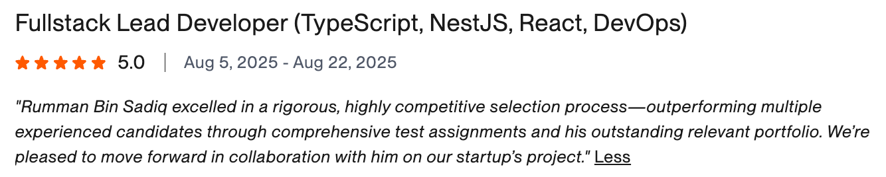
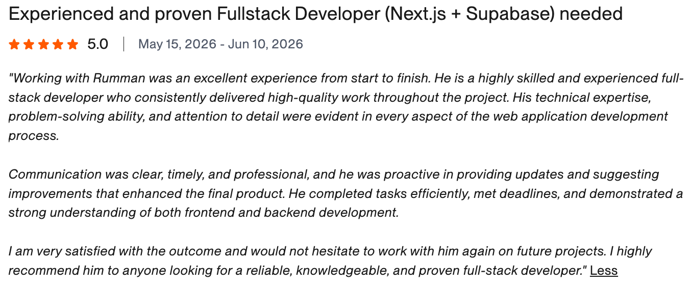
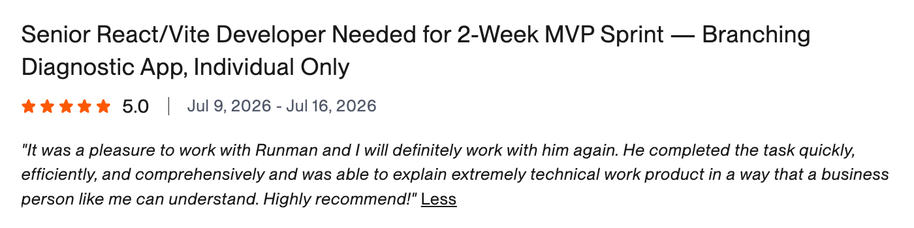
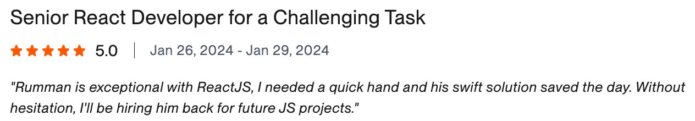

# Hi, I'm Rumman 👋

### Full-Stack AI Engineer · AI Agent Developer

I build AI products and full-stack web apps for startups and founders. 
8+ years in, based in Mississauga, Canada.

 

<table align="center">
<tr>
<td align="center" width="140"><h3>$100K+</h3>earned on Upwork</td>
<td align="center" width="140"><h3>100%</h3>job success</td>
<td align="center" width="140"><h3>Top Rated Plus</h3>on Upwork</td>
<td align="center" width="140"><h3>125+</h3>projects shipped</td>
</tr>
</table>

 

## What I do

- **AI agents & automation:** agents that use tools, multi-step workflows, RAG, and LLM features that make it into production
- **SaaS & MVPs:** from a rough idea to a working product, with auth, billing, dashboards and multi-tenancy
- **Cloud & DevOps:** Next.js on AWS, Supabase, Vercel, migrations and secure infrastructure

## How I work

I use Claude Code and Cursor every day, and they let me move a lot faster. I still make the architecture calls myself and review everything before it ships.

I own the work from planning to launch, send short daily updates, and push back when something in the plan doesn't make sense. When a project wraps up, you get docs and walkthrough videos, so your team isn't stuck depending on me.

## Recent work

| Project | Stack |
| --- | --- |
| Lead developer for an early-stage startup | TypeScript, NestJS, React, DevOps |
| React app with ChatGPT integration, plus mentoring the team | React, OpenAI, Node.js |
| Zero-trust AWS infrastructure for a Next.js/Supabase app | AWS, Supabase, Vercel |
| Supabase → AWS migration | Supabase, AWS |
| MVP for a branching diagnostic app, shipped in one week | React, Vite, TypeScript |
| Financial calculators for a fintech product | React, TypeScript |

**Before freelancing:** Senior engineer at Pulsespace, Devsinc and FivetoNine. Along the way I've also worked on Fastyr, HeroGeneration, Bullhorn, Pupilfirst and Magic Makers.

## What clients say

 

  

 

  

 

  

 

  

 

## Why work with me

- Every completed job so far has a 5-star rating
- Most clients hire me again
- I've shipped the full stack myself, from frontend and backend to AI features and cloud infrastructure
- I explain technical trade-offs in plain English

## Stack

 

## Get in touch

Got a product idea or a codebase that needs help? Email me at **[rummansadiq@gmail.com](mailto:rummansadiq@gmail.com)** and tell me what you're building.
