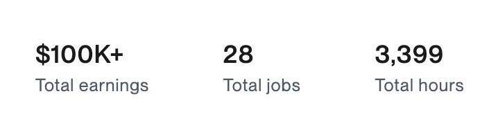
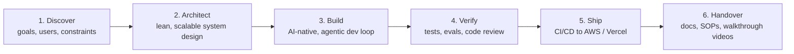
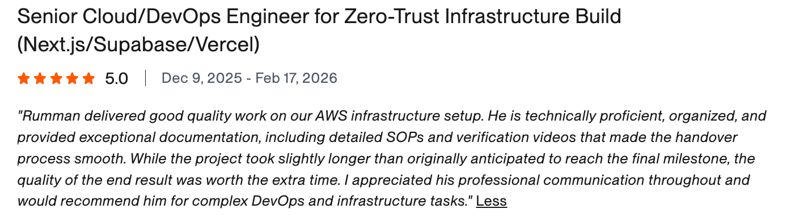
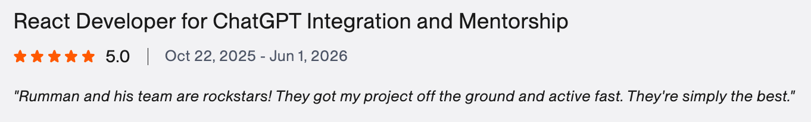
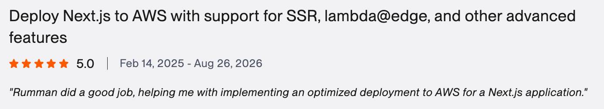
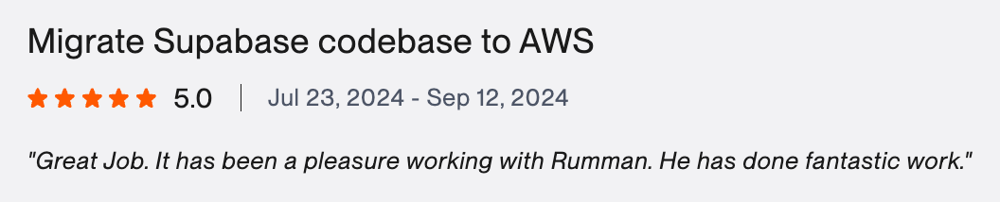
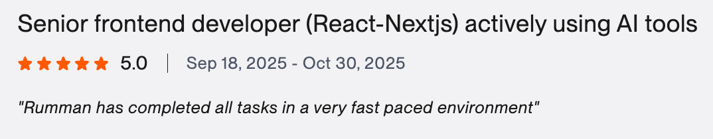

# Rumman Sadiq

### AI-Native Full-Stack Engineer · AI Agent Developer · Agentic Systems Builder

**I design, build, and ship production AI products (AI agents, LLM apps, RAG systems, and scalable full-stack SaaS) for founders, startups, and product teams.**

📍 Mississauga, Canada · 🟢 Open for work · ⚡ Replies in 0–4 hours · 🕒 30+ hrs/week

---

## Proof, Not Promises

<table>
<tr>
<td align="center" width="16%"><h3>$100K+</h3>Earned on Upwork</td>
<td align="center" width="16%"><h3>100%</h3>Job Success Score</td>
<td align="center" width="16%"><h3>Top Rated+</h3>Top ~3% of Upwork talent</td>
<td align="center" width="16%"><h3>3,399</h3>Billed hours</td>
<td align="center" width="16%"><h3>125+</h3>Projects shipped</td>
<td align="center" width="16%"><h3>8+ yrs</h3>Industry experience</td>
</tr>
</table>

  

---

## Quick Answers for Clients

| You're asking | Jump to |
| --- | --- |
| **What does Rumman do?** | [What I Do](#what-i-do) |
| **How does he work, and how does he use AI?** | [How I Work](#how-i-work) |
| **What has he actually built?** | [What I've Done](#what-ive-done) |
| **Who has he worked with?** | [Who I've Worked With](#who-ive-worked-with) |
| **What do his clients say?** | [Client Feedback](#client-feedback) |
| **Why Rumman over other developers?** | [Why Rumman](#why-rumman) |

---

## What I Do

I'm a **full-stack AI engineer and full-stack web developer** who owns the whole product, from strategy and system design to deployment and handover. I use modern **AI-native, agentic engineering workflows** to ship faster without taking on tech debt.

<table>
<tr>
<td width="33%" valign="top">

### 🤖 AI Agents & Agentic Systems

- Autonomous **AI agents** & tool-calling LLMs
- **Multi-agent orchestration** & agentic workflows
- **MCP** (Model Context Protocol) integrations
- Human-in-the-loop approvals & guardrails
- AI workflow automation that cuts ops cost

</td>
<td width="33%" valign="top">

### 🧠 Generative AI & LLM Apps

- **RAG** (Retrieval-Augmented Generation)
- Semantic search & knowledge systems
- Document intelligence platforms
- ChatGPT / Claude / Gemini integrations
- Embeddings, vector DBs, prompt engineering & evals

</td>
<td width="33%" valign="top">

### 🚀 Full-Stack SaaS & Web

- **AI-powered SaaS** & startup **MVPs**
- **Multi-tenant** platforms & **Stripe** subscriptions
- Customer portals, dashboards & internal tools
- APIs, integrations & backend systems
- Cloud/DevOps on **AWS, Vercel & Supabase**

</td>
</tr>
</table>

> 💡 **Building from scratch or fixing a live product?** Send me your scope, Figma, or codebase. I'll map out the right tech stack, infrastructure, and execution plan on a quick call.

---

## How I Work

**AI is my engineering multiplier, not a replacement for judgment.** I build with **Claude Code, Cursor, and GitHub Copilot** alongside structured context, automated checks, and human review. You get the speed of an AI-native developer and the decisions of a senior engineer.

| Principle | What it means for you |
| --- | --- |
| **Full-stack ownership** | I don't just close tickets. I own the work from architecture to launch. |
| **Strategic input** | I research options, flag edge cases, and propose better ways to solve the problem. |
| **High autonomy** | I ship complete features without needing hand-holding. |
| **Scalable execution** | Clean, lightweight architecture that holds up as real users arrive, with zero tech debt. |
| **Stress-free communication** | Daily updates, so you never have to chase me for status. |
| **Business-friendly explanations** | Complex technical work explained in plain language that founders and business owners understand. |
| **Clean handover** | Detailed documentation, SOPs, and verification videos, as clients have noted in their reviews. |

<b>✅ I'm a great fit if you… / ❌ I'm not a fit if you…</b>

 

**✅ Great fit if you want:**
- A partner who owns delivery end to end, from architecture to launch
- Someone who questions product logic and makes the idea better
- Complete features shipped without micromanagement
- Code that scales without piling up tech debt

**❌ Not a fit if you want:**
- A passive task-taker who codes specs without thinking
- Rigid hourly oversight instead of real outcomes
- Quick, messy hacks that break once real users arrive

Some clients bring a complete specification. Others bring only an idea and a rough direction. **I'm comfortable with both.**

---

## What I've Done

**125+ projects** delivered across AI, SaaS, fintech, cloud infrastructure, and web platforms. Every completed Upwork job shown below is rated **5.0 ★**.

### Selected Client Engagements (Upwork-verified)

| Engagement | What I delivered | Stack | Rating |
| --- | --- | --- | --- |
| **Fullstack Lead Developer for a Startup** | Hired as lead engineer after **beating multiple experienced candidates** in a rigorous, competitive selection with test assignments | TypeScript · NestJS · React · DevOps | ⭐ 5.0 |
| **AI / ChatGPT Integration & Mentorship** | Got a React product off the ground and live fast, with ChatGPT-powered features and hands-on mentorship | React · OpenAI · Node.js | ⭐ 5.0 |
| **Senior Frontend Dev Using AI Tools** | AI-assisted delivery of every task in a very fast-paced team | React · Next.js · AI coding tools | ⭐ 5.0 |
| **Zero-Trust Cloud Infrastructure Build** | Secure, production-grade AWS infrastructure for a Next.js/Supabase/Vercel stack, handed over with SOPs & verification videos | AWS · Next.js · Supabase · Vercel | ⭐ 5.0 |
| **Next.js on AWS (SSR + Lambda@Edge)** | Optimized AWS deployment with SSR, Lambda@Edge & advanced Next.js features (long-term engagement: Feb 2025 → Aug 2026) | Next.js · AWS · Lambda@Edge | ⭐ 5.0 |
| **Supabase → AWS Migration** | Migrated a production Supabase codebase to AWS | Supabase · AWS · Node.js | ⭐ 5.0 |
| **2-Week MVP Sprint: Branching Diagnostic App** | A complete MVP shipped in **one week** of a two-week sprint | React · Vite · TypeScript · Node.js · Vercel | ⭐ 5.0 |
| **Full-Stack Web App** | End-to-end frontend + backend delivery, on time, with proactive product improvements | Next.js · Supabase | ⭐ 5.0 |
| **Fintech Financial Calculators** | Suite of interactive financial calculators (181 hours) | React · TypeScript | ⭐ 5.0 |
| **Senior React Developer: Urgent Fix** | A "saved the day" fix for a challenging React problem, delivered in 3 days | React · JavaScript | ⭐ 5.0 |
| **Custom Interactive Map** | Data-driven interactive business location map | WordPress · JavaScript · Mapbox | ⭐ 5.0 |

### Impact Highlights

- 🏗️ **Scalable, high-performance systems.** Designed end-to-end architectures for AI, SaaS & web platforms, built for **99.9% uptime**, faster page speeds, and higher retention and conversion.
- 🤖 **AI automation & agentic workflows.** Built autonomous agent workflows that helped an AI client **cut operational costs and response times**.
- 📈 **SaaS product development.** Delivered end-to-end SaaS platforms with intuitive dashboards, task coordination, secure messaging, and **AI-driven personalized guidance**.

### Open Source & Experiments

| Repo | What it is |
| --- | --- |
| [monorepo-nestjs-nextjs-tauri](https://github.com/RummanSadiq/monorepo-nestjs-nextjs-tauri) | Monorepo starter: NestJS API + Next.js web + Tauri desktop app |
| [copy-email-phone](https://github.com/RummanSadiq/copy-email-phone) | Zero-config Chrome extension that copies email & phone links with a native toast |
| [EC-2-Setup](https://github.com/RummanSadiq/EC-2-Setup) | Shell automation for provisioning AWS EC2 servers |
| [Nerd-Wallet-Calc](https://github.com/RummanSadiq/Nerd-Wallet-Calc) | Financial calculator components in TypeScript |

---

## Who I've Worked With

### Platforms & Products I've Engineered For

  <b>Fastyr</b> &nbsp;·&nbsp; <b>HeroGeneration</b> &nbsp;·&nbsp; <b>Bullhorn</b> &nbsp;·&nbsp; <b>Pupilfirst</b> &nbsp;·&nbsp; <b>Magic Makers</b>

### Career Timeline

| Role | Company | Period |
| --- | --- | --- |
| **AI-Native Full-Stack Engineer (Independent)** | Upwork: Top Rated Plus, 28 contracts | Present |
| **Senior Full-Stack Developer** | FivetoNine | 2022 – 2023 |
| **Senior Software Engineer** | Devsinc | 2018 – 2020 |
| **Senior Software Engineer** | Pulsespace | 2016 – 2018 |

**Who hires me:** startup founders building AI-first MVPs, SaaS companies scaling their product, fintech teams, and product owners who need a senior engineer to take full ownership. **Most of my clients come back for multiple projects.**

---

## Client Feedback

**Every completed Upwork job listed here is rated 5.0 ★.** These are real client words, and the screenshots are below.

> ### ⭐⭐⭐⭐⭐ "Outperforming multiple experienced candidates"
> *"Rumman Bin Sadiq excelled in a rigorous, highly competitive selection process—outperforming multiple experienced candidates through comprehensive test assignments and his outstanding relevant portfolio. We're pleased to move forward in collaboration with him on our startup's project."*
>
> **Fullstack Lead Developer (TypeScript, NestJS, React, DevOps)**

> ### ⭐⭐⭐⭐⭐ "A reliable, knowledgeable, and proven full-stack developer"
> *"Working with Rumman was an excellent experience from start to finish. He is a highly skilled and experienced full-stack developer who consistently delivered high-quality work throughout the project. His technical expertise, problem-solving ability, and attention to detail were evident in every aspect of the web application development process.*
>
> *Communication was clear, timely, and professional, and he was proactive in providing updates and suggesting improvements that enhanced the final product. He completed tasks efficiently, met deadlines, and demonstrated a strong understanding of both frontend and backend development.*
>
> *I am very satisfied with the outcome and would not hesitate to work with him again on future projects. I highly recommend him to anyone looking for a reliable, knowledgeable, and proven full-stack developer."*
>
> **Experienced and Proven Fullstack Developer (Next.js + Supabase)**

> ### ⭐⭐⭐⭐⭐ "Explains technical work so a business person can understand"
> *"It was a pleasure to work with [Rumman] and I will definitely work with him again. He completed the task quickly, efficiently, and comprehensively and was able to explain extremely technical work product in a way that a business person like me can understand. Highly recommend!"*
>
> **Senior React/Vite Developer: 2-Week MVP Sprint**

> ### ⭐⭐⭐⭐⭐ "Exceptional documentation… recommended for complex DevOps"
> *"Rumman delivered good quality work on our AWS infrastructure setup. He is technically proficient, organized, and provided exceptional documentation, including detailed SOPs and verification videos that made the handover process smooth. […] I appreciated his professional communication throughout and would recommend him for complex DevOps and infrastructure tasks."*
>
> **Senior Cloud/DevOps Engineer: Zero-Trust Infrastructure Build (Next.js/Supabase/Vercel)**

<table>
<tr>
<td width="50%" valign="top">

> ⭐⭐⭐⭐⭐ 
> *"Rumman and his team are rockstars! They got my project off the ground and active fast. They're simply the best."*
>
> **AI / ChatGPT Integration & Mentorship**

</td>
<td width="50%" valign="top">

> ⭐⭐⭐⭐⭐ 
> *"Rumman is exceptional with ReactJS, I needed a quick hand and his swift solution saved the day. Without hesitation, I'll be hiring him back for future JS projects."*
>
> **Senior React Developer: Urgent Fix**

</td>
</tr>
<tr>
<td width="50%" valign="top">

> ⭐⭐⭐⭐⭐ 
> *"Rumman did a fantastic job, he showed great knowledge, the communication was smooth and he worked with high efficiency."*
>
> **Custom Interactive Map**

</td>
<td width="50%" valign="top">

> ⭐⭐⭐⭐⭐ 
> *"Great Job. It has been a pleasure working with Rumman. He has done fantastic work."*
>
> **Supabase → AWS Migration**

</td>
</tr>
<tr>
<td width="50%" valign="top">

> ⭐⭐⭐⭐⭐ 
> *"Rumman did a good job, helping me with implementing an optimized deployment to AWS for a Next.js application."*
>
> **Next.js on AWS (SSR + Lambda@Edge)**

</td>
<td width="50%" valign="top">

> ⭐⭐⭐⭐⭐ 
> *"Rumman has completed all tasks in a very fast paced environment"*
>
> **Senior Frontend Developer (React/Next.js) Using AI Tools**

</td>
</tr>
</table>

### What Clients Endorse Most (Upwork Insights)

### Verified Reviews (screenshots from [Upwork](https://www.upwork.com/freelancers/~01f7d25fb1277fb026))

  

  

  

  

  
  

  
  

  

---

## Why Rumman

| | Typical freelancer | **Rumman** |
| --- | --- | --- |
| **Track record** | New or unverified | **$100K+ earned · 100% JSS · Top Rated Plus · 5.0★** |
| **Experience** | Junior to mid-level | **8+ years**, senior roles at Devsinc & FivetoNine |
| **AI capability** | Adds a chatbot wrapper | **Production AI agents, RAG & agentic workflows** that add real business value |
| **Speed** | Slow, or fast but messy | **AI-native delivery**: MVPs in weeks, built right the first time |
| **Scope** | Frontend *or* backend | **True full stack**: UI, APIs, databases, AI & cloud/DevOps |
| **Mindset** | Codes the ticket | **Improves the product idea** and flags edge cases early |
| **Code quality** | Tech debt you pay for later | **Clean, scalable architecture** with zero tech debt |
| **Communication** | You chase them for updates | **Daily updates** and replies in 0–4 hours |
| **Handover** | "It works on my machine" | **Docs, SOPs & verification videos** |
| **Vetting** | Hired on a cheap bid | **Picked over multiple experienced candidates** in competitive technical selections |
| **Retention** | One-off gigs | **Most clients hire me for multiple projects** |

---

## Tech Stack

**AI, Agents & LLMs**

**AI-Native Dev Tooling**

**Frontend**

**Backend & APIs**

**Data, Cloud & DevOps**

---

## Education & Certifications

- 🎓 **Bachelor of Computer Science (Software Engineering)**, COMSATS Institute of Information Technology (2013 – 2017)
- 📜 **Generative AI for Everyone**, DeepLearning.AI (2025)
- ✅ **Upwork ID & phone verified**

---

## Let's Build Your AI Product

**Do you have an active project, a Figma design, or just an idea?** 
Send me your scope or code. I'll break down the right stack, architecture, and timeline.

AI Engineer · AI Agent Developer · Agentic AI · LLM Engineer · RAG · MCP · Generative AI · Full-Stack AI Engineer · Full-Stack Web Developer · Next.js · React · Node.js · NestJS · TypeScript · Supabase · AWS · SaaS · MVP Development

